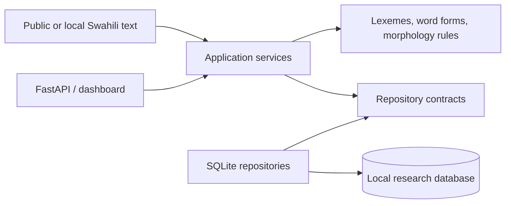

# Swahili Linguistic Intelligence

A research-oriented Python toolkit and FastAPI application for structured Swahili lexical and morphological analysis. The repository focuses on computational morphology, Bantu noun classes, lexical knowledge, corpus-oriented ingestion, and reproducible linguistic data workflows.

This is an alpha research system. It is not production-ready, and it is not currently a retrieval-augmented generation (RAG) implementation: there is no evidence-to-generation pipeline or LLM in the runtime path. The historical package/repository name is retained only where compatibility may require it.

## Why this project exists

Swahili is morphologically rich and agglutinative. A surface form such as `ninakupenda` can encode subject, tense/aspect, object, lexical root, and final vowel within one orthographic word. Treating every observed string as an independent “term” loses those relationships. The current domain contract therefore separates:

- `Lexeme`: abstract lexical/semantic anchor;
- `WordForm`: observed or generated surface realization;
- `Meaning`: semantic content owned by a lexeme;
- `Context`: attested usage;
- `Derivation`: relation between lexemes;
- `VerbComponents`: structured verbal morphology.

`SwahiliTerm` remains as a compatibility model while persistence is gradually migrated toward the lexeme-first ontology.

## Capability status

Implemented:

- heuristic Swahili tokenization, normalization, stopword removal, and frequency statistics;
- noun-class inference for the classes documented in [LINGUISTIC_SPEC.md](LINGUISTIC_SPEC.md);
- heuristic prefix/root/final-vowel and verbal-component analysis;
- lexeme/word-form construction for analyzed forms;
- SQLite repositories and deterministic seed fixtures;
- FastAPI endpoints for lexical lookup, morphology, dictionary/news records, a transparent lexicon-based sentiment baseline, and experimental batch/export workflows;
- bounded HTTP(S) fetching with redirect validation and rejection of non-public network targets;
- static-first corpus acquisition with structured extraction, Swahili validation,
  content hashing, provenance, JSONL manifests, and exact deduplication;
- a Streamlit local research/demo dashboard.

Experimental:

- generic article extraction from static HTML;
- URL language/content quality detection;
- CoNLL/BIO/TSV/JSON-LD research exports and dataset splitting;
- batch URL processing and dashboard/API integration.

Planned:

- stronger lexeme-first persistence;
- calibrated morphology confidence and linguistic error analysis;
- calibrated language evaluation, near-duplicate detection, and content version history;
- site-aware extraction only where public static/structured evidence requires it.

## Linguistic analysis

The analyzer uses existing rule modules and is explicitly heuristic. It does not claim to be a finite-state morphological analyzer. In current output:

- surface form is the attested token (`ninasoma`);
- lemma is the canonical lexical form (`kusoma`);
- the stored verbal root/stem-like radical is `som`;
- the final vowel is represented separately as `a`;
- grammatical prefixes may be decomposed into subject and tense/aspect markers.

This terminology and the frozen examples are defined in [LINGUISTIC_SPEC.md](LINGUISTIC_SPEC.md). Ambiguous forms can be misclassified; current outputs should not be treated as gold annotations.

## Architecture



See [docs/ARCHITECTURE.md](docs/ARCHITECTURE.md) for dependency and route details.

## Database

SQLite is the default and currently tested relational backend. Persistence is
implemented through SQLAlchemy and repository boundaries, so no external database
server is required for local research, tests, or demonstrations. This separation
preserves a future migration path to another relational backend if justified by
deployment requirements, but no alternative database is currently claimed as tested.

Web corpus documents intentionally remain in content-addressed filesystem storage with
a JSONL manifest; they are not forced into the relational database. See
[docs/DATABASE_ARCHITECTURE.md](docs/DATABASE_ARCHITECTURE.md).

## Responsible crawl orchestration

Responsible Crawl Orchestration v1 adds an origin-scoped, robots-aware, rate-limited,
budgeted, persistent frontier above single-page acquisition. Interrupted crawl jobs can
resume from SQLite checkpoints without blindly reacquiring completed pages. Corpus
artifacts remain owned by Web Corpus Acquisition v1. See
[docs/RESPONSIBLE_CRAWL_ORCHESTRATION.md](docs/RESPONSIBLE_CRAWL_ORCHESTRATION.md).

## Installation

Python 3.13.5 is the interpreter validated in the current engineering session. Metadata permits Python 3.10+, but other versions still require CI verification.

```bash
python3 -m venv .venv
source .venv/bin/activate
python -m pip install -e '.[web,dev]'
```

Add `dashboard` for Streamlit or `research` for the larger data/ML toolchain:

```bash
python -m pip install -e '.[web,dashboard,dev]'
```

## Running locally

```bash
python -c "from src.infrastructure.database import init_db; init_db()"
python scripts/seed_release1_alpha.py
uvicorn src.web.api:app --reload
```

The interactive API documentation is at `http://localhost:8000/docs`. To run the optional dashboard:

```bash
streamlit run streamlit_app.py
```

## API

The current application exposes health, terms, dictionary, noun-class classification, root extraction, sentiment baseline, news storage/statistics, URL analysis, batch, and research-helper routes. Treat `/analyze/url` and batch/export routes as experimental. Full verified route details belong in [docs/API.md](docs/API.md).

## Testing and measured coverage

```bash
pytest
pytest --cov=src --cov-branch --cov-report=term-missing
black --check src tests scripts streamlit_app.py
isort --check-only src tests scripts streamlit_app.py
flake8 src tests
mypy src
```

The initial measured baseline on 2026-08-12 was 106 collected tests, 10 failures in the focused domain/application subset, and 35% total branch-aware coverage. The active session is correcting these results; see [docs/TECHNICAL_AUDIT.md](docs/TECHNICAL_AUDIT.md) and [docs/SESSION_REPORT.md](docs/SESSION_REPORT.md) for the final exact figures. No >90% coverage claim is made.

## Data provenance

Committed data is limited to small deterministic seed fixtures, migration material, and data-source instructions. Downloaded corpora, processed data, databases, embeddings, logs, reports, and backups are ignored by Git. See [data/raw/README.md](data/raw/README.md), [SEED_DATA.md](SEED_DATA.md), and [DATA_STORAGE_GUIDE.md](DATA_STORAGE_GUIDE.md).

## Limitations

- Morphology and noun-class identification are rule-based heuristics with no calibrated confidence yet.
- Noun lemmas are not normalized from plural to singular.
- Sentiment is a small lexicon baseline, not a context-sensitive model.
- Static paragraph extraction can include or omit boilerplate and does not prove that content is Swahili.
- URL safety checks reduce obvious SSRF exposure but do not replace deployment-level egress controls and DNS pinning.
- Several legacy persistence tables remain term-centric.
- Batch jobs are in-memory and are not durable across process restarts.

## Web acquisition roadmap

Future acquisition is static-first: inspect HTTP/HTML metadata, structured data, semantic containers, public feeds/endpoints, and only then consider browser rendering. It explicitly excludes access-control, CAPTCHA, authentication, and paywall bypass. See [docs/WEB_ACQUISITION_ROADMAP.md](docs/WEB_ACQUISITION_ROADMAP.md).

## Contributing

Read [CONTRIBUTING.md](CONTRIBUTING.md) and preserve the lexeme/word-form distinction. Changes to morphology should include linguistically meaningful regression cases and should label uncertainty rather than hiding it.

## Scientific Provenance

This project was conceived and developed in Brazil by a Brazilian developer and researcher whose native language is Portuguese. English is used as the primary technical language to make the software and research internationally accessible, while preserving its Brazilian scientific and technological provenance.

## Proveniência Científica

Este projeto foi concebido e desenvolvido no Brasil por um desenvolvedor e pesquisador brasileiro, falante nativo de português. O inglês é utilizado como língua técnica principal para tornar o software e a pesquisa internacionalmente acessíveis, sem apagar sua origem brasileira e seu compromisso com a soberania científica e tecnológica nacional.

License: MIT.
