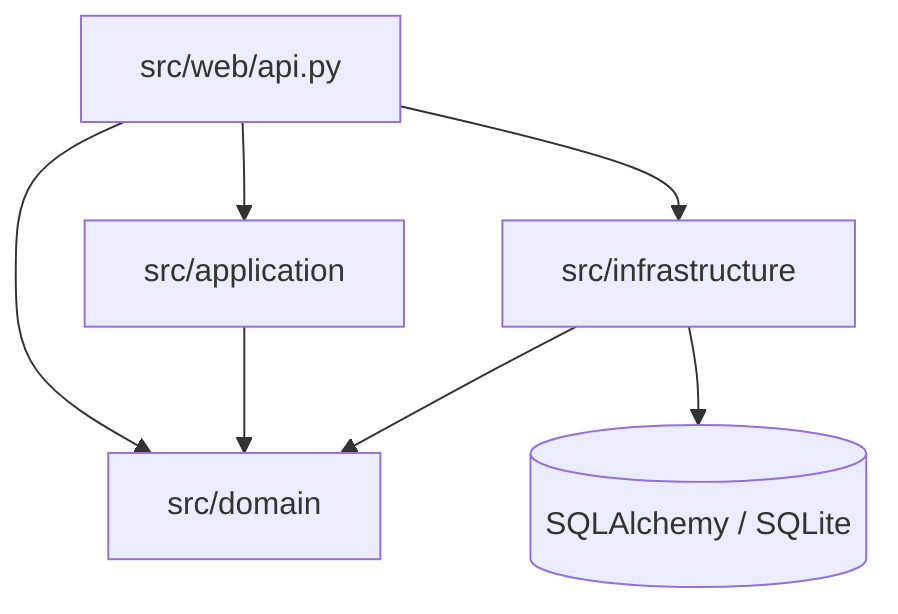

# Architecture

Status: verified high-level map, 2026-08-12.

The repository currently uses four broad layers:

- `src/domain`: linguistic entities, value objects, rule data, services, and repository contracts.
- `src/application`: text/URL/batch/export services and ingestion use cases.
- `src/infrastructure`: configuration, SQLAlchemy models/connections, and repository implementations.
- `src/web`: the synchronous FastAPI transport layer.

The linguistic core is lexeme-first: `Lexeme` owns `WordForm`, `Meaning`, and `Context`; `SwahiliTerm` remains a legacy compatibility object. The morphology implementation is heuristic and must expose that uncertainty rather than being described as a complete analyzer.

## Dependency Direction

The domain is framework-independent. Web composition currently imports concrete repositories directly; dependency functions isolate construction but do not constitute a fully inverted composition root.

## Linguistic Data Path

Surface input is normalized, assigned a heuristic word type, analyzed with centralized noun/verbal markers, projected into `WordForm`, and attached to a `Lexeme`. Verbal output separates the radical (`som`) from the final vowel (`a`) and may expose subject, tense/aspect, object, polarity, and full prefix.

## Ingestion and Data Path

- `scripts/01_ingest_masakhane.py`: local POS-style source → normalized terms/POS records → SQLite.
- `scripts/02_ingest_ner.py`: local NER source → terms/entity records → SQLite.
- `scripts/03_ingest_news.py`: local TSV news source → news records → SQLite; it is not a crawler.
- `scripts/04_ingest_kamusi.py`: local CSV/JSON dictionary source → terms/dictionary records → SQLite.
- `data/seed`: deterministic local demonstration fixtures.

Downloaded raw data is source material; `data/processed`, databases, embeddings, reports, logs, and backups are generated artifacts.

## API Surface

The monolithic API currently groups 19 application routes across root/health, terms, noun classification, morphology, sentiment, news, statistics, dictionary, URL analysis, batch, and research helpers (plus OpenAPI documentation routes). Batch job state is process-local and non-durable. Trend output remains placeholder-style and must not be described as database aggregation.

## Known Boundary Debt

- Transport routes instantiate application services and depend on concrete repositories.
- SQL schema remains centered on `terms`; it does not persist the complete lexeme-first ontology.
- URL acquisition and linguistic analysis are coupled in one application service.
- Batch and export modules are large and lightly tested.
- Router extraction may help, but should follow schema/behavior tests rather than precede them.
