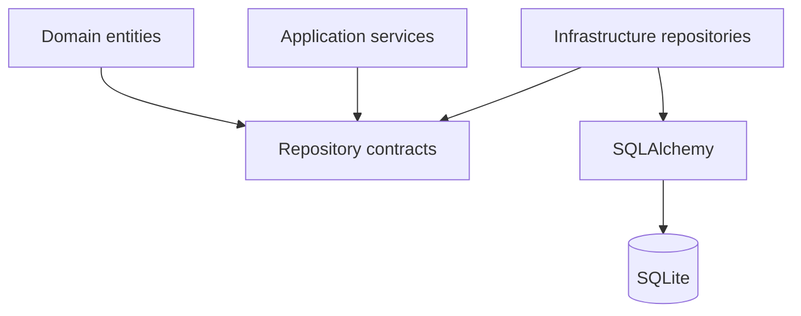

# Database Architecture

## Current Backend

SQLite is the official default and currently tested relational backend. The default
project-relative URL is `sqlite:///data/swahili_knowledge.db`; normal development and
tests require no external database server.

## ORM / Persistence Layer

SQLAlchemy implements persistence behind repository contracts. Domain entities and
application behavior do not depend on SQLite connections, sessions, paths, or SQL.



## Why SQLite

SQLite is an intentional fit for a local-first, research-oriented alpha system: it is
reproducible, dependency-light, easy to install, and adequate for demonstrations and
individual research workflows at the current scale.

## SQLite-Specific Behavior

- A 30-second busy timeout reduces transient `database is locked` failures.
- `check_same_thread=False` supports FastAPI's threaded request execution model.
- `PRAGMA foreign_keys=ON` is installed on every pooled SQLite connection.
- These settings are localized in `src/infrastructure/database/connection.py`.

## Portability Risks

The legacy migration uses SQLite syntax including `AUTOINCREMENT`, `DATETIME`,
`CURRENT_TIMESTAMP`, `PRAGMA`, and `sqlite_master`. ORM models use legacy untyped
declarative mappings and naive datetimes. Pool and concurrency behavior is validated
only on SQLite. These are migration considerations, not proof of another backend.

## Raw SQL and Migrations

Runtime repositories use SQLAlchemy query construction rather than embedded raw SQL.
`data/migrations/v0.1.0_initial_schema.sql` is an active SQLite-specific baseline;
the migration README describes a lightweight manual workflow. Alembic is not added
solely for appearance. A future backend change would require dedicated migration
tooling and integration tests.

## Corpus / Database Separation

Structured application and linguistic records use SQLite through SQLAlchemy. Acquired
web documents use content-addressed JSON files and a JSONL manifest. This separation is
intentional and avoids turning SQLite into a bulk corpus object store.

## Future Migration Path

```text
SQLite
↓ demonstrated concurrency, deployment, or corpus-scale requirement
candidate relational backend
↓ backend-specific integration tests
migration design and tooling
↓ verified deployment
operational adoption
```

SQLAlchemy and repository boundaries preserve a migration path, but migration is not
assumed to be automatic. No alternative relational backend is currently certified.
