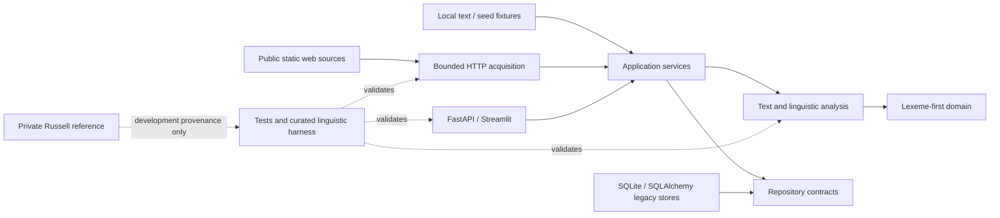

# Project Layer Status

Measured 2026-08-12. Status labels describe implemented reality, not plans.

| Layer | Status | Confidence | Main Strength | Main Gap |
|---|---|---:|---|---|
| Linguistic | FUNCTIONAL | High | Lexeme-first morphology and curated regressions | Heuristic ambiguity and incomplete realization |
| Domain | FUNCTIONAL | High | Focused entities/value objects | Legacy `SwahiliTerm` boundary |
| Application | PARTIAL | High | Working analysis/export services | Ingestion use cases untested |
| Persistence | PARTIAL | High | Tested SQLite repositories | Term-first schema, no mature migrations |
| API | FUNCTIONAL | High | Tested FastAPI alpha routes | Oversized module and legacy route vocabulary |
| Web acquisition | EXPERIMENTAL | High | Bounded SSRF-aware static fetch/inspection | Not a crawler or robust extractor |
| Corpus/data | EXPERIMENTAL | High | Ignore/provenance conventions | No reproducible corpus pipeline |
| NLP/analysis | PARTIAL | High | Transparent morphology/text baselines | No calibrated disambiguation |
| Testing/evaluation | FUNCTIONAL | High | 142 tests and branch measurement | Several major modules remain weakly covered |
| Security | PARTIAL | Medium | URL and secret hygiene | No deployment hardening/dependency audit |
| Tooling | PARTIAL | High | Reproducible pyproject and clean formatter/type check | 156 repository-wide Ruff findings |
| Documentation | FUNCTIONAL | High | Architecture, audit, linguistic provenance | Some historical material is stale |
| Interface | LEGACY | Medium | Streamlit demo exists | Weakly tested and coupled to API |
| Research readiness | FUNCTIONAL | Medium | Traceable rules and deterministic tests | Gold corpus and error analysis absent |
| Production readiness | EXPERIMENTAL | High | Coherent alpha foundation | Operations, auth, migrations, scale absent |

## 1. Linguistic Layer

Status: **FUNCTIONAL**. M/WA, N, KI/VI, JI/MA, M/MI, U and grouped
locative classes exist. Prefix-based membership is useful but ambiguous.
Agreement is now separately typed, including an explicit animate override.
Verbal analysis separates radical-like root and final vowel and supports core
affirmative markers plus regular negative present/past/future. Derivation and
locative semantics remain partial; automatic animacy, loan behavior, relatives,
imperatives, confidence and morphophonemic realization are weak or missing.
Twenty-one indexed source rules and fourteen new curated cases provide initial
traceability.

## 2. Domain Layer

Status: **FUNCTIONAL**. `Lexeme`, `WordForm`, `Meaning`, `Context` and
`Derivation` encode the intended ontology with tested invariants.
`VerbComponents` is additive and backward compatible. `SwahiliTerm` remains a
necessary legacy projection and causes coupling at persistence/API boundaries.

## 3. Application Layer

Status: **PARTIAL**. Text, URL, batch and export services exist; deterministic
exports and core orchestration are tested. Kamusi and Masakhane ingestion use
cases are present but have zero measured coverage. Batch jobs are in-memory and
error handling is inconsistent.

## 4. Persistence / Database Layer

Status: **PARTIAL**. SQLAlchemy 2 and SQLite repositories have transaction and
round-trip tests with explicit sessions. The schema remains term-first while the
domain is lexeme-first. Migration infrastructure is skeletal, session lifecycle
is suitable for local alpha use, and production database behavior is unverified.

## 5. Backend / API Layer

Status: **FUNCTIONAL** for local alpha use. FastAPI exposes health, terms,
dictionary, classification, root extraction, news, statistics, URL analysis,
batch and research export helpers. Smoke and integration routes pass. Dependency
overrides work, but `src/web/api.py` still combines schemas, wiring, state and
routes in one large module. There is no full `/word` lexeme endpoint matching the
target ontology, contextual translator, or semantic search implementation.

## 6. Web Acquisition Layer

Status: **EXPERIMENTAL**. Implemented acquisition validates schemes, credentials,
DNS-resolved public addresses, redirects, content type and size. Static
inspection recognizes semantic article markup, JSON-LD, OpenGraph, feeds and
sitemap hints. Extraction remains generic and language validation/deduplication
are weak. This is not a crawler; scheduling, robots policy, retries, provenance
manifests and rendered-browser acquisition are future work.

## 7. Corpus / Data Engineering Layer

Status: **EXPERIMENTAL**. Raw/processed storage policies, deterministic seed data
and export formats exist. A real Swahili web corpus still needs source manifests,
license records, content hashes, canonical deduplication, language-quality gates,
incremental runs, versioned processed artifacts and reproducibility tests.

## 8. NLP / Analysis Layer

Status: **PARTIAL**. Normalization, tokenization, frequencies, keyword extraction,
heuristic morphology, noun classification, batch analysis and research exports
work. Sentiment is correctly described as a small lexicon baseline, not AI.
There is no statistical tagger, contextual disambiguator, calibrated confidence,
or evidence-based semantic search.

## 9. Testing / Evaluation Layer

Status: **FUNCTIONAL**. Final measurement: 143 collected, 142 passed, 0 failed,
1 optional network test skipped, 65% branch-aware coverage. The linguistic
addition contains 14 cases; API smoke/integration, SQLite and acquisition tests
pass. Ingestion, logging, batch paths and repository edge cases remain weak.

## 10. Security Layer

Status: **PARTIAL**. Secrets and runtime data are ignored, and fetching blocks
obvious local/private targets and revalidates redirects. The private PDF is
ignored. Remaining needs include DNS rebinding/egress defenses at deployment,
authentication/authorization, rate limits, dependency scanning, secure headers,
upload policies and production secret management.

## 11. Developer Experience / Tooling

Status: **PARTIAL**. `pyproject.toml`, dependency groups, pytest, Black, isort,
Ruff and mypy are available in `.venv`. Black, isort and mypy pass. Scoped Ruff
on touched/new files passes after excluding documented legacy findings;
repository-wide Ruff reports 156 pre-existing issues. Python 3.10+ metadata has
only been exercised here on Python 3.13.5.

## 12. Documentation Layer

Status: **FUNCTIONAL**. README, architecture, API, audit, refactor plan,
acquisition roadmap, worklog and linguistic contract exist. The Russell index,
terminology contract and harness report add provenance. Historical documents can
still conflict with measured current behavior and should remain clearly archived.

## 13. Dashboard / Interface Layer

Status: **LEGACY**. Streamlit provides a useful local demonstration over the API,
but is large, weakly tested, catches broad exceptions and has lint findings. It
is not evidence of a supported production UI.

## 14. Research Readiness

Status: **FUNCTIONAL** for portfolio, undergraduate/TCC experimentation and small
computational-linguistics studies when limitations are cited. It is not ready for
claims based on a representative corpus or gold-standard accuracy. Those require
licensed datasets, independent annotation, inter-annotator checks, error analysis
and versioned experiments.

## 15. Production Readiness

Status: **EXPERIMENTAL**. Portfolio readiness is not production readiness.
Production requires lexeme-first migrations, durable jobs, observability,
authentication, rate limiting, deployment egress controls, backups, rollback and
disaster tests, multi-version CI, load testing, dependency governance, service
objectives and a maintained corpus pipeline.

## Real current architecture

## Recommended Next 10 Tasks

1. **Priority: P0 · Layer: Linguistic.** Add lexical evidence and alternative analyses for ambiguous noun prefixes. **Why:** prefix matching overclaims membership. **Expected impact:** fewer false noun classes.
2. **Priority: P0 · Layer: Linguistic.** Build ordered derivational-extension parsing with applicative/passive/stative/reciprocal fixtures. **Why:** extensions are currently opaque strings. **Expected impact:** meaningful derivation analysis.
3. **Priority: P0 · Layer: Persistence.** Design additive Lexeme/WordForm tables and migration compatibility views. **Why:** storage contradicts the domain center. **Expected impact:** durable ontology consistency.
4. **Priority: P1 · Layer: Evaluation.** Create an independently reviewed gold set with ambiguity labels. **Why:** synthetic cases cannot estimate real accuracy. **Expected impact:** defensible error metrics.
5. **Priority: P1 · Layer: Linguistic.** Add morphophonemic concord realization and foreign-origin verb handling. **Why:** underlying markers are not surface forms. **Expected impact:** usable agreement/paradigm generation.
6. **Priority: P1 · Layer: API.** Add a structured `/word/{lemma}` lexeme-first response while retaining compatibility routes. **Why:** public API is still term-first. **Expected impact:** exposes the intended knowledge model.
7. **Priority: P1 · Layer: Corpus.** Implement provenance manifests, hashes, language gates and canonical deduplication. **Why:** no reproducible corpus pipeline exists. **Expected impact:** trustworthy ingestion experiments.
8. **Priority: P1 · Layer: Application.** Test and harden Kamusi/Masakhane use cases and durable batch boundaries. **Why:** both ingestion modules have 0% measured coverage. **Expected impact:** safer data workflows.
9. **Priority: P2 · Layer: API.** Split schemas, dependencies and route groups out of `api.py`. **Why:** current concentration impedes maintenance. **Expected impact:** clearer ownership and tests.
10. **Priority: P2 · Layer: Tooling.** Ratchet Ruff by directory and remove naive UTC usage in touched layers. **Why:** 156 findings and 154 warnings obscure regressions. **Expected impact:** cleaner CI signal.
