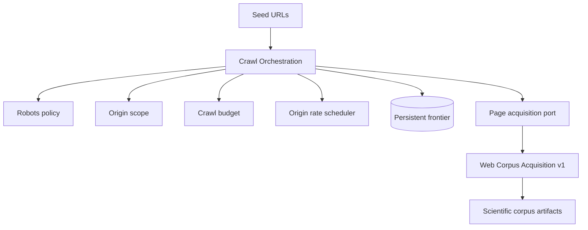
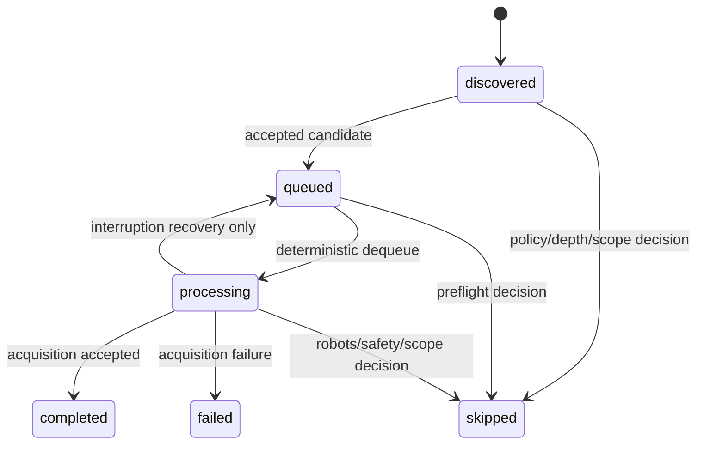
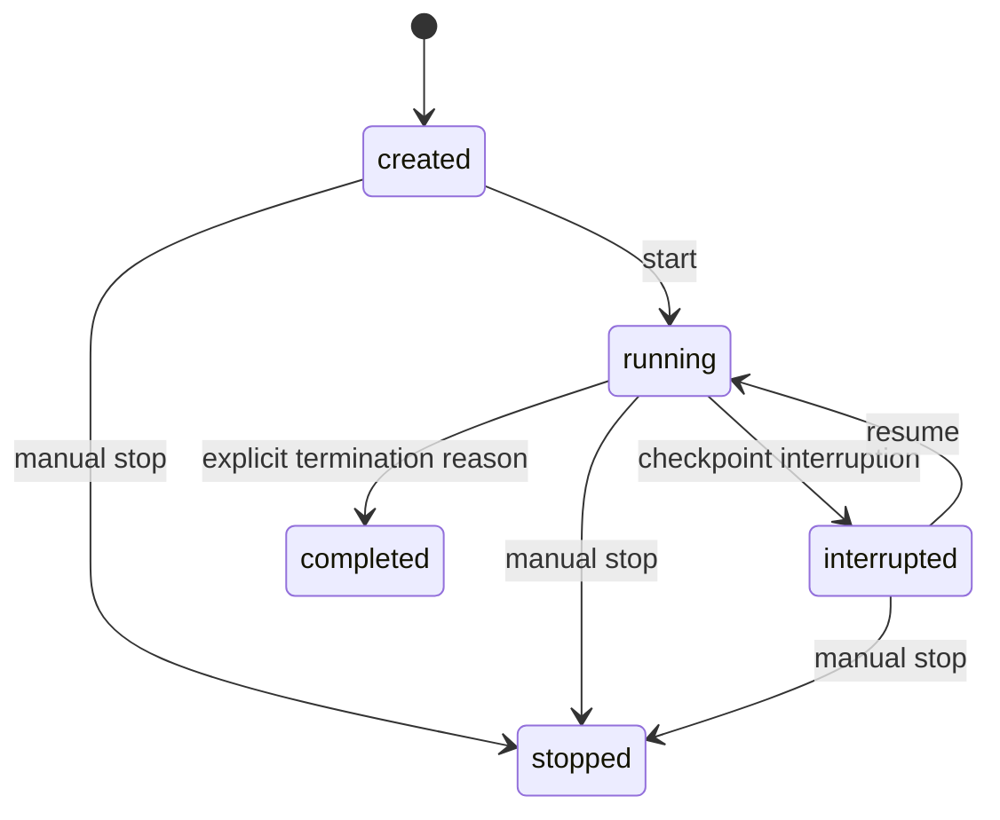
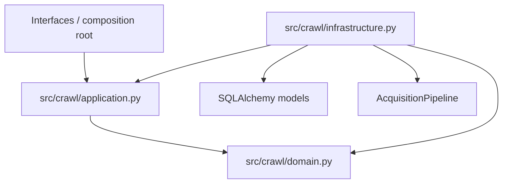

# Responsible Crawl Orchestration v1

## Problem Statement

Web Corpus Acquisition v1 turns one eligible public resource into a validated,
provenance-preserving corpus artifact. It does not decide which resource should be
visited next, whether a publisher permits that visit, when another request is
responsible, or when a multi-page run must stop. Responsible Crawl Orchestration v1
adds those bounded operational decisions without duplicating acquisition or linguistic
analysis.

## Context and System Flow



Orchestration decides **what**, **when**, and **how far**. Acquisition decides how an
eligible page is inspected, extracted, normalized, language-validated, hashed,
deduplicated, attributed, and stored. Linguistic Intelligence remains a downstream,
independent consumer of accepted Swahili content.

## Ubiquitous Language

- **Crawl**: one bounded execution over seed and discovered URLs.
- **Crawl job**: the aggregate recording configuration, counters, lifecycle, and
  termination for one crawl.
- **Seed**: an explicitly supplied initial URL at depth zero.
- **Frontier**: the durable, deterministically ordered set of resource candidates.
- **Frontier entry**: an entity identifying one canonical URL within one job.
- **Canonical URL**: conservative HTTP(S) identity with normalized origin, fragment
  removal, default-port removal, sorted query pairs, and known tracking parameters
  removed.
- **Origin**: the scheme, host, and effective non-default port used for scope, robots,
  rate scheduling, and per-origin accounting.
- **Crawl depth**: the number of discovery edges from a seed.
- **Crawl budget**: immutable page, depth, failure, and per-origin limits.
- **Robots exclusion**: an explicit policy decision that prevents acquisition.
- **Domain scope**: the configured set of allowed origins; v1 defaults to seed origins.
- **Checkpoint**: the transactionally persisted job and frontier state after progress.
- **Resume**: continuation of an interrupted job after recovering `processing` entries.
- **Termination reason**: an explicit expected explanation for why processing ended.

“Domain-scoped” in this document means origin-scoped (`scheme://host[:port]`), which is
stricter and less ambiguous than hostname-only scope.

## Bounded Context

The Crawl Orchestration bounded context owns job lifecycle, canonical frontier
identity, frontier transitions, robots decisions, origin scope, request pacing, crawl
budgets, checkpoints, and operational reporting. It calls Web Corpus Acquisition
through a narrow port and persists its own operational aggregate through a repository.

It does not own morphology, linguistic analysis, extraction, language validation,
content hashing, corpus deduplication, corpus file layout, browser automation,
FastAPI, SQLAlchemy, or SQLite. Corpus storage is called only inside the acquisition
adapter. Crawl code receives an outcome and artifact identifier, not corpus internals.

## Domain Model

`CrawlJob` is the aggregate root. It owns immutable seeds, allowed origins, budget and
pacing configuration plus lifecycle and consumed counters. `FrontierEntry` is an
entity whose identity is `(job_id, canonical_url)`; entries are persisted alongside
the job but transition through their own explicit state machine. `CrawlUrl`,
`CrawlBudget`, `RatePolicy`, `RobotsPolicy`, and `RobotsDecision` are value/policy
objects because their validated value and behavior matter, not independent identity.

`CrawlRepository` is the aggregate persistence boundary. `RobotsPolicyService` is a
domain-oriented policy coordinator with a lifecycle cache. `OriginRateScheduler`
applies `RatePolicy` using a clock port. `CrawlOrchestrator` is the application service.
No event bus or stored domain-event stream is introduced: v1 has one synchronous
coordinator, durable state is already observable, and events would add delivery
semantics without a consumer.

## Aggregate Invariants

| Invariant | Enforcement | Direct coverage |
|---|---|---|
| One canonical URL per job | `CrawlUrl`, repository add contract, SQLite unique constraint | domain, persistence, cycle tests |
| Completed/failed/skipped entries are terminal | `FrontierEntry.transition` | forbidden-transition tests |
| Only interrupted processing may return to queued | explicit processing-to-queued transition used by repository recovery | recovery and resume tests |
| Pages and failures never exceed budgets | job counters checked before dequeue/acquisition | budget tests |
| Depth beyond the limit never reaches acquisition | discovery and pre-acquisition guards | depth orchestration test |
| Robots-denied pages never reach acquisition | policy guard before scheduler/acquisition | robots orchestration test |
| Unsupported/unsafe URLs never reach acquisition | `CrawlUrl` plus `UrlSafetyPort` at seed, discovery, and processing | URL and orchestration tests |
| External origins require explicit scope | `allowed_origins` on the aggregate and application guards | scope test |
| Every completed run has a reason | `CrawlJob.finish` requires `TerminationReason` | lifecycle and budget tests |
| Resume does not reacquire completed URLs | terminal state plus deterministic queued dequeue | resume test |

Database constraints reinforce identity and referential integrity; they do not replace
the domain transitions or budget behavior.

## State Machines



`completed`, `failed`, and `skipped` are irreversible. Recovery is deliberately narrow:
only entries persisted as `processing` are reset to `queued`, keeping attempt metadata.



## Layered Architecture



The domain imports neither SQLAlchemy, SQLite, FastAPI, nor acquisition modules.
Application code depends on domain types and ports. Infrastructure implements those
ports and performs persistence mapping. No new public HTTP route was added in v1;
composition through the application service keeps conservative limits under the
control of a future CLI or API boundary.

## Application Use Cases

- `start`: validate/canonicalize seeds, establish default origin scope, create the job,
  enqueue seeds, and checkpoint.
- `run`: enforce budgets, dequeue deterministically, apply scope/safety/robots/rate
  policies, delegate acquisition, discover links, and checkpoint until termination.
- `interrupt`: persist an explicit interrupted state.
- `resume`: reload configuration and counters, recover orphaned processing entries,
  then continue without reacquiring completed pages.
- `stop`: persist a manual terminal state.
- `inspect`: return typed counts, budget use, skip reasons, and termination state.

## Ports and Adapters

`PageAcquisitionPort` is the anti-corruption boundary. `WebAcquisitionAdapter` safely
fetches once and delegates the HTML to the existing `AcquisitionPipeline`; its output
is reduced to success, final URL, discovered static links, artifact ID, and reason.
`UrlSafetyPort` is implemented by the existing public URL validator.
`RobotsRetrieverPort` uses the same redirect-revalidating, response-bounded safe fetch.
`ClockPort` has a system adapter and deterministic test doubles. `CrawlRepository` has
a SQLAlchemy implementation. These ports keep network, timing, persistence, and corpus
details out of domain behavior.

## Persistence Architecture

Operational state uses two relational tables:

- `crawl_jobs`: aggregate identity, serialized seeds/origin scope, immutable limits,
  lifecycle, counters, and timestamps.
- `crawl_frontier`: entry identity, job foreign key with `ON DELETE CASCADE`, canonical
  URL/origin, parent discovery URL, depth, state, reasons, attempts, and timestamps.

`UNIQUE(job_id, canonical_url)` reinforces frontier identity. The repository orders
dequeue by `(depth, id)`, giving deterministic breadth-first behavior and source-order
tie breaking. One repository method is one transaction/checkpoint; orchestrator calls
checkpoint after meaningful state changes. Existing `Base.metadata.create_all` adds
the tables under the current lightweight schema initialization convention. SQLite
foreign keys remain enabled by the existing connection hook.

### Domain Model vs Persistence Model

`CrawlJob` and `FrontierEntry` express behavior and invariants. `DBCrawlJob` and
`DBCrawlFrontier` are mutable SQLAlchemy rows with serialization fields. Mapping is
owned by `SqlAlchemyCrawlRepository`; neither application ports nor domain callers see
ORM models or sessions. Repository calls commit their unit of state, while corpus
storage remains a separate acquisition transaction boundary.

## robots.txt Reasoning

The retriever requests `{origin}/robots.txt` through the existing SSRF-aware fetcher,
including redirect revalidation and response limits. A 404/410 means “missing” and is
allowed; unreachable or syntactically malformed policy fails closed. This conservative
failure policy avoids silently crawling when publisher policy cannot be established.
Policies are cached once per origin for an orchestrator lifecycle.

The parser supports user-agent groups, `Allow`, `Disallow`, wildcard and end-anchor
path matching, longest-match precedence, and non-negative `Crawl-delay`. Crawl delay is
evidence for pacing, never a replacement for the configured minimum. An allow/deny
decision records a machine-readable reason.

## Rate Scheduler Reasoning

The domain rule is that successive requests to one origin respect the greater of the
configured minimum and robots delay. Different origins have independent timestamps.
`RatePolicy` computes required wait; `ClockPort` provides monotonic time and sleep.
Unit tests advance a fake clock and never sleep in real time. Scheduler state is owned
by an orchestrator instance and therefore isolated from unrelated jobs by composition.

## Frontier Reasoning

Canonical identity is conservative: arbitrary query parameters remain because they
may identify different articles. Static relative links are resolved against the final
resource URL, fragments are removed, and unsupported, unsafe, external, over-depth,
and duplicate outcomes are excluded before acquisition. First discovery retains its
parent URL and timestamp. SQL identity makes repeated and cyclic links harmless.

## Budget Reasoning

`max_pages` caps attempted acquisitions, `max_depth` caps discovery distance,
`max_failures` stops a degraded run, and `per_origin_pages` caps completed pages at one
origin. Budgets are immutable job configuration and persisted for resume. Exhaustion is
an expected domain outcome (`page_budget_exhausted` or
`failure_budget_exhausted`), never an infrastructure exception. Depth and per-origin
rejections become inspectable skipped entries; the per-origin cap counts completed and
failed acquisition attempts. If no candidates remain the job ends as
`frontier_exhausted`.

## Checkpoint and Resume

Configuration, counters, statuses, frontier entries, parent relationships, attempts,
and reasons are stored after progress. `resume` accepts only interrupted jobs. Before
running, it converts orphaned `processing` rows to eligible `queued` rows. Completed,
failed, and skipped entries remain terminal. Consumed page/failure counters are loaded
from the job and cannot reset on restart.

## Failure Semantics

Robots exclusion, unsafe/unsupported URL, duplicate, external scope, depth rejection,
and budget exhaustion are expected decisions represented by states/reasons. Network,
extraction, or language-rejection outcomes returned by acquisition are page failures
and consume the failure/page budgets. Invalid aggregate transitions and missing jobs
are programming/use-case errors. An unrecoverable persistence failure remains an
exception because reliable checkpoint state cannot be claimed.

## Corpus and Acquisition Boundaries

Crawl operational state changes frequently and requires transactional queue identity,
so SQLite/SQLAlchemy is appropriate. Scientific corpus artifacts are immutable,
content-addressed JSON plus a JSONL manifest and remain outside SQLite. The acquisition
pipeline alone owns normalization, Swahili validation, SHA-256 deduplication,
provenance, and corpus serialization. Adapter tests verify repeated acquisition still
uses the corpus manifest deduplicator rather than a crawl-layer substitute.

## Security and Responsible Crawling

Only HTTP(S) canonical values are admitted. Existing DNS/IP validation rejects local,
private, reserved, and credential-bearing targets and is applied again after redirects.
Robots policy, origin scope, deterministic pacing, page/depth/failure limits, and
bounded response handling all precede acquisition. Application-level SSRF checks do
not eliminate DNS rebinding; a public deployment still needs egress controls or
connection-level address pinning. No JavaScript, browser, credentials, paywall bypass,
or private content is used.

## Scientific Reproducibility

Given the same persisted checkpoint and adapter outcomes, canonicalization, breadth-
first ordering, state transitions, budgets, skip reasons, and timing calculations are
deterministic. Tests control clocks and network outcomes with local fixtures. Live web
content, DNS, redirects, and publisher robots files are mutable, so a live crawl itself
is not claimed to be perfectly reproducible. Parent URLs, timestamps, artifact IDs,
and explicit decisions preserve the evidence available for review.

## Testing Strategy

Domain tests cover value validation, budgets, transitions, terminal states, and rate
calculation. Application tests cover robots outcomes/cache, deterministic scheduling,
cycles, duplicates, relative/fragment links, scope, safety, depth, all budgets,
interruption and resume. Persistence tests use temporary SQLite files to prove unique
identity, deterministic dequeue, foreign keys, reload, and processing recovery.
Adapter tests prove safe robots retrieval and reuse of acquisition/corpus deduplication.
All network behavior is fake; the normal suite requires no Internet.

## Agent Compatibility

No agent exists in v1. Future controlled tools can call start, inspect, interrupt, and
resume use cases, but those capabilities sit above the same application service. They
cannot supply a page directly to acquisition while bypassing robots, scope, safety,
pacing, budgets, or provenance. No agent framework or autonomous loop is introduced.

## Known Limitations

- One synchronous worker processes a job; distributed locking is not implemented.
- Robots parsing covers core RFC path semantics, not every nonstandard extension.
- Unreachable/malformed robots policies fail closed with no retry schedule.
- Scheduler timestamps are process-local and are reconstructed after process restart;
  the configured minimum applies again from the first resumed request.
- Discovery is static anchor extraction without semantic scoring, feeds, sitemaps,
  rendered DOM, JavaScript, or browser inspection.
- Failed entries are terminal in v1; only interrupted `processing` entries recover.
- No public API or CLI composition root is exposed yet.

## Architecture Decisions

### Operational state in SQLite and separate corpus artifacts

**Context:** frontier state is transactional and mutable; corpus artifacts are
scientific records. **Decision:** store jobs/frontier in SQLite through SQLAlchemy and
keep corpus JSON/JSONL storage unchanged. **Rationale:** each store matches its access
pattern. **Consequences:** acquisition and crawl commits are separate and an artifact
may succeed immediately before a crawl checkpoint failure. Resume can safely delegate
again because corpus storage is idempotent. **Alternatives considered:** an in-memory
frontier loses recovery; putting queue rows in manifests conflates operations and data.

### Persistent, origin-scoped frontier with explicit budgets

**Context:** unrestricted recursion is unsafe and irreproducible. **Decision:** use a
unique persistent frontier, seed-origin scope by default, deterministic breadth-first
ordering, and immutable limits. **Rationale:** bounds are domain invariants rather than
caller conventions. **Consequences:** cross-origin discovery requires explicit scope
and every run has a predictable ceiling. **Alternatives considered:** unrestricted
recursion and route-level limit checks were rejected because they permit bypass.

### Checkpoint/resume with processing recovery

**Context:** a process can stop after dequeue. **Decision:** checkpoint every state
change and reset only `processing` entries on resume. **Rationale:** pending work remains
eligible while completed resources remain terminal. **Consequences:** an interrupted
page may be acquired twice across the smallest failure window, but acquisition
deduplication prevents duplicate corpus artifacts. **Alternatives considered:** leaving
processing orphaned loses work; resetting all entries reacquires completed pages.

### Acquisition anti-corruption boundary

**Context:** crawling and scientific acquisition have different responsibilities.
**Decision:** depend on `PageAcquisitionPort`, implemented by an adapter around the
existing pipeline. **Rationale:** extraction, language validation, hashing and corpus
layout remain authoritative in one place. **Consequences:** orchestration sees a small
outcome model. **Alternatives considered:** reimplementing extraction or exposing
pipeline internals would couple bounded contexts.

### Deterministic scheduler abstraction

**Context:** responsible pacing needs time but tests must not sleep. **Decision:** keep
rate calculation in a policy and inject monotonic clock/sleep mechanics. **Rationale:**
timing behavior is deterministic and separately testable. **Consequences:** scheduler
memory is per composed service instance. **Alternatives considered:** direct scattered
`sleep` calls hide policy and slow tests.

### Browser, distributed infrastructure, events, and agents deferred

**Context:** static, bounded v1 needs no dynamic rendering or distributed execution.
**Decision:** add no Playwright/Selenium, PostgreSQL, Redis, Celery, broker, event bus,
or agent framework. **Rationale:** these do not improve the core invariants and would
increase operational risk. **Consequences:** dynamic pages remain unsupported and work
is single-process. **Alternatives considered:** browser-first and agent-driven crawling
were rejected because they enlarge the trusted surface before deterministic policies
are established.

## Evolution Path

```text
Responsible Crawl Orchestration v1
        ↓
Public Swahili Corpus Pilot
        ↓
Corpus Quality / Acquisition Metrics
        ↓
Browser Inspector
        ↓
Rendered DOM Inspection
        ↓
XHR / fetch / Network Inspection
        ↓
Structured Public Endpoint Discovery
        ↓
controlled future agent tools
```

Each later capability must remain below the same policy gates and above the existing
scientific acquisition boundary.
