# Web Corpus Acquisition

Status: static P0/P1 implemented; browser assistance planned.

```mermaid
flowchart LR
  Web[Public HTTP/S] --> Fetch[Bounded safe fetch]
  Fetch --> Inspect[PageInspector]
  Inspect --> Select[Strategy selector]
  Select --> Extract[JSON-LD / article / main / paragraphs]
  Extract --> Normalize[Unicode and paragraph normalization]
  Normalize --> Lang[Heuristic Swahili validation]
  Lang --> Identity[Canonical URL and SHA-256]
  Identity --> Store[Immutable JSON + JSONL manifest]
  Store --> NLP[Optional application/NLP services]
```



`AcquisitionPipeline.process_html` is the deterministic core and accepts fetched
HTML, keeping network policy separate and testable. It returns a `WebDocument`
with original/final/canonical URLs, source metadata, raw and normalized text,
language evidence, extraction metadata, content hash, retrieval time and
implementation version. Missing metadata remains `None`.

The network adapter also exposes `FetchResult`, preserving requested/final URL,
HTTP status, content type, HTML and a timezone-aware retrieval timestamp. The legacy
`fetch_url()` HTML-only interface remains available. Seed-page candidate discovery is
static, non-recursive, requires an explicit domain allowlist, and enforces `max_urls`.

Run one public page with:

```bash
python -m src.acquisition.ingest https://example.org/article --dry-run
python -m src.acquisition.ingest https://example.org/article --output data/corpus
```

Downloaded corpus files are ignored. Normal tests use synthetic offline fixtures.
The language score is a transparent heuristic, not a calibrated probability.
Exact duplicates are rejected first by canonical URL and then normalized-content
hash using an incremental manifest scan. Changed content at an existing canonical URL
is not overwritten in v1. Unsafe declared canonical URLs fall back to the final URL.

Acquisition is for public material only. It does not bypass authentication,
CAPTCHAs, paywalls or access controls. Application URL checks reduce SSRF risk but
do not replace deployment egress controls or DNS-rebinding defenses.
