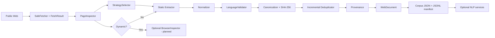

# Web Acquisition Session Report

## Environment

Validation ran on WSL2 kernel 6.18.33.2 with 12 logical CPUs, 3.8 GiB RAM,
1.0 GiB swap, and 952 GiB free on the repository filesystem. The repository is
under native WSL `/home`, not `/mnt/c`. The existing project-local Linux `.venv`
uses Python 3.12.3 and pip 26.2.1; `pip check` reported no broken requirements.
No GPU tooling or heavyweight research dependencies were introduced.

## Starting Git state

The clean starting commit was `373aa9c` on `main`, matching `origin/main`.
Existing history and remotes were preserved. Work moved to the local branch
`feat/web-corpus-acquisition-v1`; nothing was pushed and no remote was changed.
Ignored caches, coverage output, `.venv`, and corpus output remained untracked.

## Baseline validation

The new-machine suite collected 155 tests: 154 passed, one optional live-network
test skipped, and none failed. Global branch-aware coverage was 68% in 12.95 seconds.
The FastAPI application and acquisition modules imported successfully.

Repository-wide mypy was not clean on this checkout: it reported 76 pre-existing
errors in 11 non-acquisition files. Targeted mypy for acquisition and the fetcher
passes. Black's Python 3.12 process could not complete its safety check against a
repository that includes Python 3.13 syntax; touched files are covered by Ruff,
isort, compilation through tests, and manual diff review.

## Existing Page Inspector assessment

The transferred implementation already inspected canonical and language metadata,
title, OpenGraph, nested JSON-LD types, semantic containers, paragraphs, links,
feed/sitemap hints, script volume and static/dynamic evidence. This session made
BeautifulSoup attribute handling explicit and typed, retaining malformed-data safety.
The CLI now reports final fetch metadata around the inspection result.

## Architecture implemented

## WebDocument model

The existing focused model remains canonical: content-derived document ID, all URL
identities, domain, defensible metadata, timezone-aware retrieval, language evidence,
raw and normalized text, SHA-256, extraction details and acquisition provenance.

## Extraction strategies

Implemented strategies remain JSON-LD article, semantic article, main content and
filtered generic paragraphs, with explicit dynamic-browser-required and unsupported
outcomes. JSON-LD arrays/graphs and malformed structured data remain supported safely.

## Language validation

Content-focused Swahili/English function-word evidence is combined with declared
language hints. Results distinguish likely Swahili, multilingual, likely non-Swahili
and uncertain. The numeric value is explicitly a heuristic score, not probability.

## Normalization

NFC, zero-width cleanup, horizontal whitespace cleanup, paragraph preservation and
exact repeated-paragraph removal remain separate from morphology and NLP output.

## Canonicalization

Fragments, default ports and known tracking parameters are removed conservatively;
content-bearing query parameters remain. Absolute credential-free HTTP(S) is now
required. Unsafe or malformed page-declared canonicals fall back to the final URL.

## Deduplication

Canonical URL remains higher priority than exact normalized-content SHA-256. The
manifest is now scanned incrementally rather than loaded eagerly. Changed content at
one canonical URL remains rejected without overwrite; historical versions are planned.

## Provenance

`FetchResult` adds requested/final URL, HTTP status, content type, HTML and a UTC-aware
retrieval time while preserving the legacy HTML-only fetch method. CLI ingestion now
passes final URL and retrieval time into the document provenance.

## Corpus storage

Documents remain immutable content-addressed JSON under `documents/`, indexed by an
append-only JSONL manifest. Remote paths and filenames are never used. Generated corpus
content stays ignored by Git.

## RSS/Atom

Bounded offline RSS/Atom parsing remains implemented, domain-filterable, DTD/entity
rejecting, and independent from final article inspection.

## Sitemap discovery

Bounded sitemap URL and sitemap-index pointer parsing remains implemented without
unrestricted recursion. This session added static seed-page link discovery requiring
an explicit domain allowlist and positive `max_urls`; it performs no network recursion.

## NLP integration

Acquisition continues to stop at a provenance-preserving `WebDocument`. Existing NLP
services can consume stored normalized text without coupling acquisition to morphology.
No settled linguistic contract or morphology module changed.

## Security findings

HTTP(S)-only validation, credential rejection, public DNS/IP checks, redirect
revalidation, timeouts, content types, identifiable user agent and response-size checks
remain. Canonical hints are not fetched. The new checks prevent unsafe canonical
schemes/credentials from entering identity. DNS rebinding is not fully solved at the
application layer; public deployment still needs controlled egress/address pinning.

## Performance/resource observations

No parallel workers were used because actual RAM is 3.8 GiB. A five-input offline demo
completed in 0.28 seconds with approximately 24 MiB maximum RSS, storing three distinct
documents. Incremental manifest scanning avoids corpus-size-proportional list memory.
No dependency appeared unnecessarily heavy for this static pipeline.

## Tests added

Seven test cases were added across fetch provenance, redirect final URL, safe canonical
identity, unsafe canonical fallback, bounded/domain-scoped seed links, invalid bounds,
and tracking-aware candidate deduplication.

## Final test results

Final suite: **162 collected, 161 passed, 1 optional-network skip, 0 failed** in
12.82 seconds. FastAPI exposed 23 routes. Inspector help, ingestion help, imports and
the offline corpus flow passed.

## Coverage

Global branch-aware coverage is **69%**. Acquisition modules other than thin CLI code
range from 86% to 100% combined statement/branch coverage; discovery is 89%, inspector
88%, pipeline 93%, and storage 91%.

## Quality checks

Ruff passes all modified Python and acquisition test files. isort passes those files.
Targeted mypy passes 9 source files. Repository-wide mypy reports the 76 pre-existing
non-acquisition errors described above. `git diff --check` passes.

## Git commits

Implementation/tests: `0cfa87f feat: harden bounded web acquisition provenance`.
The final documentation commit follows this report update. No remote publication was
performed.

## Browser inspection status

**PLANNED / deliberately deferred.** Static P0/P1 is stable and useful. No Playwright,
browser binary, credential capture or GPU-specific dependency was added.

## Known limitations

Language scoring is not calibrated; exact matching is not near-duplicate detection;
same-URL history is absent; seed discovery is candidate extraction rather than crawl
orchestration; robots evaluation and rate scheduling remain caller responsibilities.

## Blocked work

Repository-wide clean mypy and a normal Black safety check could not be reproduced on
this transferred Python 3.12 runtime. Neither blocks acquisition correctness, and both
are documented rather than hidden with broad ignores.

## Recommended next session

Add an explicit robots policy and conservative rate scheduler, then a bounded multi-page
orchestrator with resumable on-disk progress. Consider optional browser inspection only
for pages already classified as statically insufficient.
